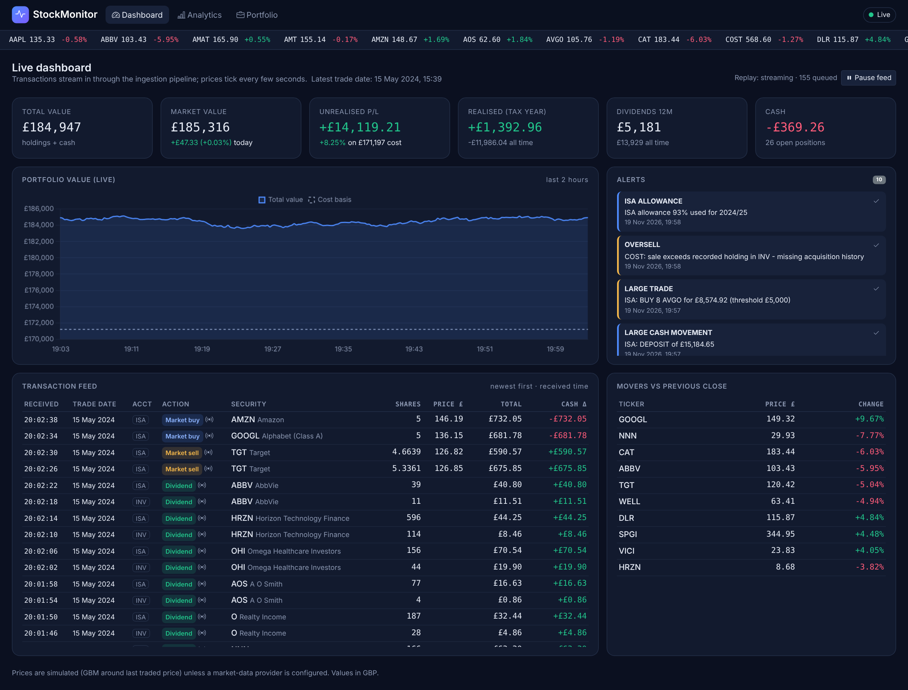
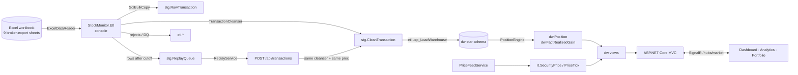

# ASP.NET-Stock-Transation-Monitor


A full-stack C# / ASP.NET Core 8 application that monitors stock transactions in real time on SQL Server.
It loads the *Open Stock Transaction Data 2020–2024* workbook (two Trading 212 accounts, a Stocks & Shares ISA
`2129` and a General Investment Account `2131`) through a documented ETL pipeline into a star schema. Then it streams
transactions and prices live to three pages:

| Page | What it shows |
|---|---|
| **Dashboard** `/` | Live KPIs (total value, day change, unrealised / realised P&L, 12-month dividends, cash), an intraday value chart, the transaction feed as events arrive, alerts, top movers, and a pause/resume control for the feed |
| **Analytics** `/analytics` | Monthly cash flows, net contributions vs net invested, dividend income (ISA vs GIA), top payers, realised gains by UK tax year, ISA allowance use, activity mix, costs and withholding tax, and pipeline / data-quality health |
| **Portfolio** `/portfolio` | Holdings with live prices (sortable, per-account toggle), allocation, P/L by holding, a drill-down drawer per security (history, corporate actions, live ticks), closed positions, and the corporate actions applied |



More screenshots are in `docs/screenshots/` (analytics, portfolio, security drill-down).



## Quick start

### Option A: Docker (SQL Server + DB scripts + ETL + web in one command)
```bash
docker compose up --build
# open http://localhost:5080
```
Compose starts SQL Server 2022 and applies `database/*.sql`. It then runs the ETL with a cutoff of `2024-01-01`:
2,771 historical rows are loaded and 528 rows from 2024 are queued. Last, it starts the web app, which streams the
queued rows in as live transactions, one every 4 seconds.

### Option B: Local SQL Server / LocalDB + .NET 8 SDK
```powershell
# 1. schema, procedures, views, reference data
./scripts/setup-db.ps1 -Server "localhost,1433" -User sa -Password "YourStrong!Passw0rd"   # or -Trusted

# 2. set the connection string in src/StockMonitor.Etl/appsettings.json and src/StockMonitor.Web/appsettings.json
#    (or env var STOCKMONITOR_ConnectionStrings__StockMonitor)

# 3. profile only (no DB writes) - prints row counts, totals and every data-quality rule hit
dotnet run --project src/StockMonitor.Etl -- --dry-run

# 4. load
dotnet run --project src/StockMonitor.Etl -- --cutoff 2024-01-01      # or --cutoff none to load everything

# 5. web
dotnet run --project src/StockMonitor.Web                             # http://localhost:5080

# tests
dotnet test
```
### Option C: Render (cloud)
The repo includes a Render Blueprint (`render.yaml`). It sets up SQL Server Express as a private service with a disk,
the ETL as a manually triggered job, and the web app as a public service. See **docs/DEPLOY_RENDER.md**, which also
covers the Azure SQL free-tier variant.

ETL flags: `--init-db` (apply `database/*.sql` without sqlcmd), `--init-only`, `--file <xlsx>`, `--cutoff yyyy-MM-dd|none`, `--reset` (clear facts and keep reference data),
`--force` (reload a file already loaded), `--dry-run`.

### Push a transaction yourself
```bash
curl -X POST http://localhost:5080/api/transactions -H "Content-Type: application/json" -d '{
  "accountNumber": 2129, "action": "Market buy", "ticker": "MSFT", "name": "Microsoft",
  "isin": "US5949181045", "shares": 3, "pricePerShare": 415.20, "priceCurrency": "USD",
  "exchangeRate": 1.27, "total": 982.40, "brokerId": "DEMO-0001" }'
```
The response is `201` when the transaction is accepted, `200` with `duplicate:true` when the same `brokerId` is
sent again (idempotent), and `422` with the rule code when cleansing rejects it. The dashboard updates within a second.

## Solution layout
```
StockMonitor.sln
database/                    SQL Server DDL, procs, views, seed (run in order, idempotent)
  01_create_database.sql     database + schemas stg / etl / dw / rt, RCSI on
  02_etl_and_staging.sql     batch log, rejects, DQ log, raw + clean staging, replay queue
  03_warehouse_and_realtime.sql  dimensions, facts, corporate actions, positions, real-time tables
  04_procedures.sql          usp_EnsureDimDate, usp_LoadWarehouse, usp_PurgeRealtime, usp_ResetWarehouse
  05_seed_reference.sql      accounts, transaction types, repaired corporate actions, date dimension
  06_views.sql               semantic views used by the web app
src/
  StockMonitor.Core/         cleansing rules, value parsers, position engine (no dependencies, unit-tested)
  StockMonitor.Data/         EF Core context + entities, WarehouseLoader (bulk copy/procs), PositionRebuildService
  StockMonitor.Etl/          console pipeline: extract -> land -> cleanse -> stage -> load -> derive -> reconcile
  StockMonitor.Web/          MVC pages, REST API, SignalR hub, ingestion, replay, price feed, snapshots, alerts
tests/StockMonitor.Tests/    xUnit tests for cleansing rules and the position engine
deploy/sqlserver/Dockerfile  SQL Server Express image for Render
render.yaml                  Render Blueprint
docs/
  DEPLOY_RENDER.md           Render deployment guide (+ Azure SQL variant, troubleshooting)
  DATA_PREPARATION.md        profiling results, quality issues found, every cleansing rule
  ETL_PIPELINE.md            batch + real-time pipelines, idempotency, lineage, reconciliation, operations
  DATA_MODEL.md              schemas, star schema, table and view reference
data/                        the source workbook
```

## REST API
| Method | Route | Purpose |
|---|---|---|
| POST | `/api/transactions` | ingest one transaction (real-time path) |
| GET | `/api/dashboard/summary?account=` | KPI block |
| GET | `/api/dashboard/recent?take=` | latest transactions by receipt time |
| GET | `/api/dashboard/alerts`, POST `/api/alerts/{id}/ack` | alert list / acknowledge |
| GET | `/api/dashboard/prices`, `/api/dashboard/snapshots?hours=` | live prices, intraday valuation |
| GET | `/api/portfolio/holdings?account=`, `/closed`, `/security/{key}`, `/corporate-actions` | portfolio read models |
| GET | `/api/analytics/cashflow`, `/dividends`, `/realized`, `/isa`, `/mix`, `/fees`, `/pipeline` | analytics |
| GET/POST | `/api/replay`, `/api/replay/pause`, `/api/replay/resume` | replay control |
| GET | `/health`, `/healthz` | readiness (incl. SQL Server) / liveness |

SignalR hub `/hubs/market` pushes these events: `transaction`, `prices`, `summary`, `snapshot`, `alert` and `replay`.

## Design notes
- **One code path for batch and stream.** The ETL and the live API use the same `TransactionCleanser` and the same
  `etl.usp_LoadWarehouse`, so a row loaded from Excel and a row posted to the API are validated and conformed
  the same way.
- **Idempotent everywhere.** Each fact is keyed on `TransactionKey`, which is the broker ID or a deterministic SHA-1
  surrogate. Re-running a batch inserts nothing new, a file with the same SHA-256 is skipped, and API retries are safe.
- **Positions are derived, not stored by hand.** `PositionEngine` replays transactions and corporate actions to build
  UK Section 104 average-cost pools per account, so splits, spin-offs and mergers are applied consistently.
- **Prices.** No market-data feed is reachable from the dataset, so `SimulatedMarketDataProvider` runs geometric
  Brownian motion from each security's last traded price. To use a vendor feed, implement `IMarketDataProvider`;
  nothing else changes.
- **Schema ownership.** The database is defined by reviewable SQL scripts, and EF Core is used only for querying and
  simple writes, with no EF migrations.

