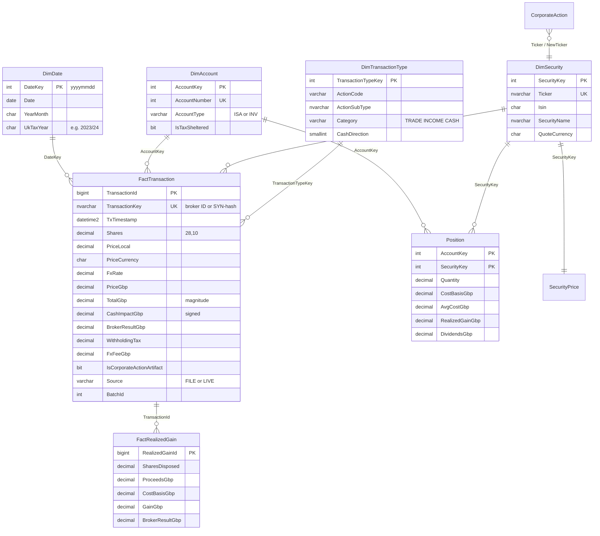

# Data model (SQL Server)

Database `StockMonitor`, four schemas:

| Schema | Purpose | Lifecycle |
|---|---|---|
| `stg` | Landing (`RawTransaction`, all text), typed staging (`CleanTransaction`), `ReplayQueue` | Append per batch; can be truncated |
| `etl` | `BatchLog`, `RejectedRow`, `DataQualityIssue`, `vw_BatchSummary` | Permanent audit trail |
| `dw` | Star schema: dimensions, facts, corporate actions, derived positions, semantic views | Facts insert-only; derived tables rebuilt |
| `rt` | Real-time operational data: prices, ticks, snapshots, alerts | Rolling retention |

## Star schema

**Grain.** `FactTransaction` has one row per broker transaction. `FactRealizedGain` has one row per disposal (a sale or a cash
acquisition). `Position` has one row per account × security, current state, with closed lines kept at quantity 0.

**Design choices**
- Amounts are stored as **magnitudes** (`TotalGbp ≥ 0`), and direction comes from `DimTransactionType.CashDirection`.
  `CashImpactGbp` keeps the signed value so cash balances are a plain `SUM`.
- `DimDate` carries the **UK tax year** (6 Apr – 5 Apr) because ISA allowances and CGT are reported on that basis.
- `DimSecurity` is SCD type 1. Ticker renames would need SCD2 or a mapping table, but none occur in this dataset.
- `TransactionKey` is the natural, idempotent key. The surrogate `TransactionId` gives a compact clustered key.
- Precision: quantities `DECIMAL(28,10)` (fractional shares up to 10 dp), prices `DECIMAL(19,6)`, money `DECIMAL(19,4)`,
  FX `DECIMAL(19,8)`.

## Indexes
| Table | Index | Serves |
|---|---|---|
| FactTransaction | `UQ_FactTransaction_Key` | idempotent load, live duplicate check |
| | `IX_FT_Account_Time` (incl. type, security, totals) | cash balances, account filters |
| | `IX_FT_Security_Time` | position rebuild, security drill-down |
| | `IX_FT_Date` | monthly analytics |
| | `IX_FT_Inserted DESC` | live feed ("newest received first") |
| PriceTick | clustered `(TickTime, SecurityKey)` | time-range reads + cheap purge |
| PortfolioSnapshot | `(SnapshotTime)` incl. value | intraday chart |
| ReplayQueue | `(ReleasedAt, TxTimestamp)` | "next pending" lookup |

## Views used by the application
| View | Used by | Notes |
|---|---|---|
| `dw.vw_TransactionDetail` | feed, drill-down, mix | flattened fact + dims + total fees |
| `dw.vw_MonthlyCashFlow` | analytics flows, dividends by month | per account × month |
| `dw.vw_DividendBySecurity` | top payers | |
| `dw.vw_CashBalance` | KPIs, snapshots | Σ CashImpactGbp |
| `dw.vw_RealizedGainByTaxYear` | gains chart/table | computed S104 gain next to broker result |
| `dw.vw_IsaAllowance` | ISA chart, alert | deposits / £20k |
| `dw.vw_Holding` | dashboard, portfolio, snapshots | position × live price; falls back to avg cost when no price |
| `etl.vw_BatchSummary` | pipeline panel | batch counts + DQ warnings/errors |

## Stored procedures
| Procedure | Purpose |
|---|---|
| `etl.usp_EnsureDimDate @From, @To` | idempotent date-dimension fill |
| `etl.usp_LoadWarehouse @BatchId, @TransactionKey = NULL, @Source = 'FILE', @RowsLoaded OUT` | conform + load (batch or single live row) |
| `rt.usp_PurgeRealtime @KeepTickHours = 24, @KeepSnapshotDays = 30` | retention |
| `etl.usp_ResetWarehouse` | dev reset (keeps reference data and audit) |
